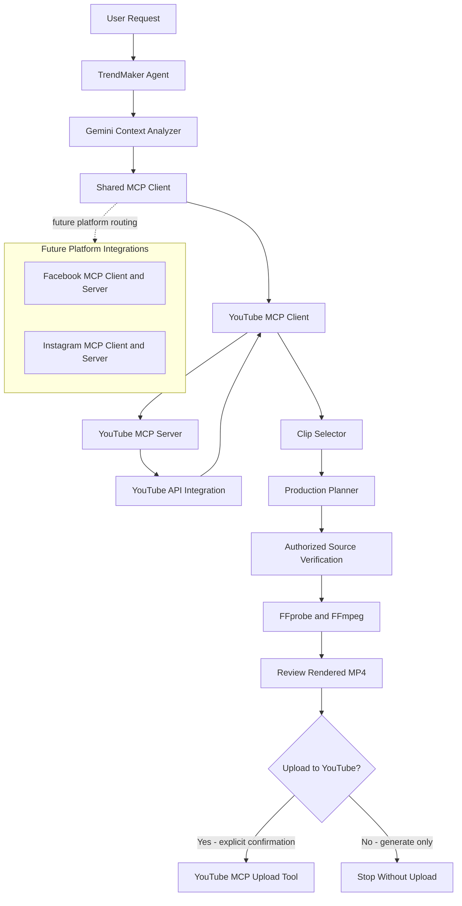

# TrendMaker AI

### Idea in. Shareable Short out.

Tell TrendMaker what you want to make. Gemini understands the topic and goal;
YouTube MCP finds candidate videos; the clip selector picks relevant sources;
and the production planner shapes them into timed scenes. After you confirm
reuse permission, `yt-dlp` gets the media, FFprobe checks it, and FFmpeg
stitches everything into a vertical MP4 with subtle motion and transitions—
then uploads it to YouTube as an unlisted video for you to review.

`Your idea → Gemini Context Analyzer → YouTube MCP search → Clip Selector → Scene Planner → Authorized sources → FFprobe → FFmpeg → Shareable 9:16 MP4`



> **Know what the AI has—and hasn't—seen:** discovery and selection use YouTube
> metadata, not footage or transcripts. A Creative Commons label is not
> independent proof of rights to everything in a video. Review the content,
> permissions, and attribution before publishing.

## What you can do

- Turn a plain-language request into structured context and a scene-by-scene
  production plan with Gemini.
- Search YouTube through a local stdio MCP server backed by the YouTube Data API.
- Rank Shorts-length candidates by view count, select clips, and keep source IDs
  connected to the plan's scenes.
- Download missing source media with `yt-dlp` only when you affirm that reuse is
  authorized.
- Inspect source duration, dimensions, frame rate, and audio with FFprobe.
- Render a normalized 1080×1920, 30 fps MP4 with FFmpeg, subtle zoom motion,
  preserved source audio, and transitions suited to the requested format.
- Render short compilations as an ordered clip sequence with bold numbered
  labels and smooth transitions between clips.
- Validate the final MP4's duration, dimensions, frame rate, and codecs before
  it is placed in `output/`.
- Replace prior render artifacts with the latest video at `output/output.mp4`.
- Clear `assets/sources/` and `output/` at the start of every full `produce` run
  so stale source videos or rendered artifacts cannot enter the next production.
- Upload the completed MP4 to YouTube as an unlisted video using OAuth.

The renderer adds numbered labels for short compilations, but no other generated
text overlays, captions, voiceover, or music. Plans may contain those as
editorial notes; source audio is preserved when present.

## The workflow: prompt to MP4

1. **Understand the request.** Gemini extracts the topic, intent, platform, and
   any requested duration.
2. **Discover candidates with MCP.** The app starts its own local YouTube MCP
   server over stdio. The `search_youtube_videos` tool calls the YouTube Data
   API and returns metadata for Creative-Commons-labeled, Shorts-length videos.
3. **Select the clips.** Gemini chooses and orders candidates using the returned
   metadata. The YouTube API does not confirm that a video is vertically
   formatted as a Short.
4. **Build the production plan.** Gemini creates timed scenes and connects each
   scene to selected source IDs. Durations and source references are validated.
5. **Verify and obtain sources.** With `--authorized-sources`, the source
   manager rechecks availability, YouTube's license label, and duration, then
   downloads missing files with `yt-dlp`.
6. **Inspect media.** FFprobe checks each source's duration, dimensions, frame
   rate, and audio. Scene time is allocated within each source's available
   footage. If no target duration was requested, the plan is shortened to fit
   available footage when necessary; a requested duration cannot exceed the
   selected sources' available footage.
7. **Render and verify.** FFmpeg scales and crops footage to vertical format,
   applies subtle motion, uses smooth transitions and numbered labels for short
   compilations, normalizes video/audio, and combines the planned clips. FFprobe
   verifies the final MP4 before it is promoted to `output/output.mp4`. The
   `output/` directory is cleared immediately before rendering.
8. **Upload and review.** After a successful render, the video is uploaded to
   YouTube as unlisted. A plan generated from a prompt is saved as
   `production-output.json`; the MP4 is written to `output/`. A plan loaded
   with `--from-file` is used as provided.

### Create a video

After setup, provide a request in PowerShell:

```powershell
npm.cmd run produce -- --authorized-sources "Create a Jensen Huang meme video for YouTube Shorts"
```

The request does not explicitly upload or publish, so the command generates
the MP4 and stops without prompting for upload.

To request upload, include the action explicitly:

```powershell
npm.cmd run produce -- --authorized-sources "Create a Jensen Huang meme video for YouTube Shorts and upload it"
```

When upload is requested, the command renders first and then asks for
confirmation before uploading the MP4 as unlisted. `--no-upload` is also
available to override a request and force generate-only behavior.

To render a saved plan without repeating Gemini planning or YouTube search:

```powershell
npm.cmd run produce -- --authorized-sources --from-file production-output.json
```

Only use `--authorized-sources` if you have permission to download and reuse
every selected source. API usage may incur charges. If YouTube reports exhausted
quota, wait for the quota reset or request additional quota; retries cannot
restore exhausted quota.

## Requirements

- Node.js and npm
- A Gemini API key from [Google AI Studio](https://aistudio.google.com/apikey)
- A YouTube Data API v3 key for discovery and source verification
- A Google Cloud Desktop OAuth client with YouTube upload enabled
- `yt-dlp`, FFmpeg, and FFprobe on `PATH` for full video production
- An NVIDIA GPU and compatible driver; production video is encoded with
  FFmpeg's `h264_nvenc` encoder

## Setup

1. Install dependencies:

   ```sh
   npm install
   ```

2. Create a local `.env` file.
3. Set `GEMINI_API_KEY` in `.env` for request analysis and production planning.
   The model setting is optional.

Example `.env`:

```dotenv
GEMINI_API_KEY=replace_with_your_api_key
# Optional; defaults to gemini-3.5-flash-lite
GEMINI_MODEL=gemini-3.5-flash-lite
# Required for YouTube discovery and source verification
YOUTUBE_API_KEY=replace_with_your_youtube_api_key
```

Never commit `.env` or share your API key. If a key is exposed, revoke it in
Google AI Studio and create a replacement.

For YouTube uploads, enable the YouTube Data API v3 in Google Cloud, create a
Desktop OAuth client, and save its downloaded JSON as
`credentials/youtube-oauth-client.json`. Authorize the YouTube channel to
receive uploads:

```powershell
npm.cmd run youtube:auth
```

This opens Google's consent flow and saves the refreshable token locally in
`credentials/youtube-upload-token.json`. Both files are ignored by Git. The
automatic upload uses the plan's title and description and always sets privacy
to **unlisted**; review the video in YouTube Studio before making it public.
OAuth authorization is separate from the `YOUTUBE_API_KEY` used for discovery.

## Explore the pipeline

| Goal | Command | Requirements |
| --- | --- | --- |
| Run the connected discovery, selection, and planning workflow | `npm run --silent workflow -- "<request>"` | Gemini and YouTube API keys |
| Analyze a request | `npx tsx src/execute/test-context.ts "<request>"` | Gemini API key |
| Run the TrendMaker MCP agent | `npm run agent:trendmaker -- "<request>"` | Gemini and YouTube API keys |
| Generate a production plan | `npx tsx src/execute/test-video-planner.ts "<request>"` | Gemini API key |
| Check/download authorized sources | `npx tsx src/execute/test-source-manager.ts` | YouTube API key and `yt-dlp` |
| Render the standalone renderer demo | `npx tsx src/execute/test-renderer.ts` | FFmpeg |
| Run tests or type checks | `npm test` / `npm run typecheck` | Dependencies installed |

Run in development mode with a topic:

```sh
npm run dev -- "indie game trailers"
```

If no topic is provided, the example topic `indie game trailers` is used:

```sh
npm run dev
```

Build and run the compiled application:

```sh
npm run build
npm start -- "indie game trailers"
```

## Configuration

| Variable | Required | Default | Description |
| --- | --- | --- | --- |
| `GEMINI_API_KEY` | Yes | None | API key used to authenticate with Gemini. |
| `GEMINI_MODEL` | No | `gemini-3.5-flash-lite` | Gemini model ID for text generation. |
| `YOUTUBE_API_KEY` | For YouTube discovery and source downloads | None | Google API key with YouTube Data API v3 enabled. |

Model availability and prices can change. Check Google's
[model documentation](https://ai.google.dev/gemini-api/docs/models) and
[pricing page](https://ai.google.dev/gemini-api/docs/pricing) before deploying
or estimating costs. API usage may incur charges depending on your account and
current pricing.

## YouTube MCP server

Use Node.js 20.3 or later. Enable the YouTube Data API v3 in Google Cloud,
configure `YOUTUBE_API_KEY`, run `npm run build`, then configure an MCP client
to launch `node` with the absolute path to `dist/mcp/youtube/youtube-mcp-server.js` as its
argument. Set `YOUTUBE_API_KEY` in the client's environment (or run from the
directory containing `.env`). The Gemini API key does not authorize YouTube
Data API access; enable that API and configure `YOUTUBE_API_KEY` separately.

The server separates planning, rendering, and publishing into MCP tools:

| Tool | Purpose | Side effect |
| --- | --- | --- |
| `search_youtube_videos` | Search and rank reusable candidate metadata | None |
| `create_video_production_plan` | Analyze, select clips, and create a plan | None |
| `render_youtube_short` | Verify sources and render the supplied plan | Creates an MP4 |
| `preview_youtube_upload` | Generate YouTube title and description | None |
| `upload_youtube_short` | Upload an MP4 to YouTube | Publishes a YouTube post |

Rendering requires `authorizedSources: true`. Uploading requires
`confirmUpload: true` and defaults to unlisted. MCP/LLM orchestration should
always stop after generation unless the user separately confirms uploading.

The `search_youtube_videos` tool accepts a nonblank `query` and optional
`maxResults` (1–50, default 50). It fetches one short-duration search page,
searches for videos marked with YouTube's Creative Commons license, confirms
the label in video details, then filters to videos at most 180 seconds long.
It returns at most 10 ordered by view count. Each result includes
`license: "creativeCommon"`. This label is not independent verification that
the uploader owns all footage, music, or other material in the video; review
the content and provide required attribution before reuse. The YouTube Data
API does not expose a reliable field confirming that a video uses the vertical
Shorts format, so these are Shorts-length candidates, not format-verified
Shorts. Each candidate's video details are fetched in one batch; no channel
playlist lookup is required.
Searches may return fewer than 10 candidates.
Missing counts and thumbnails are reported as `null`, not
fabricated values. Each API request times
out after 15 seconds; errors are returned as MCP tool errors. API quota and
service restrictions apply. Temporary rate-limit responses are retried at most
twice, respecting a short `Retry-After` delay. Exhausted daily quota is not
retried; wait for the Google Cloud quota reset or request additional quota.

To run the example discovery agent, set both API keys and run
`npm run agent:trendmaker`. It first analyzes the request with Gemini, then
uses the original request and analyzed context to guide discovery through the
YouTube MCP tool. Run `npx tsx src/execute/test-context.ts` to inspect the analyzed
context alone. Both examples accept an optional request. Analysis and
discovery each make a Gemini request and may incur charges. The executable
examples for context, discovery, planning, and the connected workflow default to
`Find the most viewed MEME YouTube Shorts about Jensen Huang`; pass a request as
an argument to override it.

## Video production planner

With `GEMINI_API_KEY` set, run the planner example:

```sh
npx tsx src/execute/test-video-planner.ts
```

The example analyzes the request and then generates a plan, making two Gemini
requests. It prints a plan with scene directions, asset requirements and
audio notes, followed by a scene timeline. Scene durations must add up to the
plan duration and, when provided, the requested duration; invalid plans fail
rather than being returned. This planner does not search YouTube, verify claims,
or obtain rights to assets.

## Connected discovery and planning

Set both API keys and optionally provide a request:

```sh
npm run --silent workflow -- "Create a 45-second gaming highlights video for YouTube Shorts"
```

The workflow analyzes the request once,
searches via the YouTube MCP tool, selects whole-video candidates from the
returned metadata, and passes the selected links and context to the production
planner. It prints the context, all search candidates, the selected candidates,
and the plan. Scene `sourceVideoIds` refer to selected candidates; those
references are tentative and require human review. The workflow makes three
Gemini requests as well as YouTube API requests.

The output is one JSON object with `context`, `candidates`, `selection`, `plan`,
and `warnings`. Each candidate has a canonical URL derived from its video ID; unavailable
statistics and thumbnails are `null`. Each planned scene references one or more
selected candidates, and every selected candidate is used by the plan. Scene
durations must total the planned duration and match the requested duration when specified.
Shorts use `9:16` and at most 180 seconds. Invalid JSON or inconsistent data produces an error
instead of a partial result.

Illustrative mock output (the video ID is a placeholder, not a search result):

```json
{
  "context": {
    "topic": "indie games", "intent": "video_creation", "platform": "YouTube Shorts",
    "targetDuration": 45, "targetAudience": "gamers", "contentStyle": "vertical highlights",
    "researchRequired": true, "actions": ["Find candidates", "Plan scenes"]
  },
  "candidates": [{
    "videoId": "VIDEO_ID", "license": "creativeCommon",
    "title": "Game trailer", "channel": "Example channel",
    "publishedAt": "2025-01-01T00:00:00Z", "durationSeconds": 60,
    "views": null, "likes": null, "comments": null,
    "url": "https://www.youtube.com/watch?v=VIDEO_ID", "thumbnail": null
  }],
  "selection": {
    "title": "Gaming highlights",
    "clips": [{
      "order": 1, "videoId": "VIDEO_ID", "license": "creativeCommon",
      "title": "Game trailer",
      "url": "https://www.youtube.com/watch?v=VIDEO_ID",
      "durationSeconds": 60, "reason": "The title is relevant to the topic."
    }]
  },
  "plan": {
    "videoTitle": "Gaming highlights", "videoDescription": "A short gaming overview.",
    "targetAudience": "gamers", "videoDurationSeconds": 45, "aspectRatio": "9:16",
    "visualStyle": "vertical highlights",
    "scenes": [{
      "sceneNumber": 1, "sceneTitle": "Introduction", "durationSeconds": 45,
      "purpose": "Introduce the topic", "visualDirection": "Review the source before use.",
      "narration": "Introduce the game.", "onScreenText": ["Gaming highlights"],
      "assetRequirements": ["Licensed visuals"], "audioDirection": "Background music",
      "sourceVideoIds": ["VIDEO_ID"]
    }],
    "musicDirection": "Upbeat", "productionNotes": ["Verify footage and reuse rights."]
  },
  "warnings": ["Only 1 Shorts-length candidate(s) available; the target is 3–4."]
}
```

Selection is based on metadata only: it does not inspect footage or transcripts,
provide timestamps, download or combine videos, or establish reuse rights.
Only candidates marked Creative Commons by YouTube reach the selector.
Review each license and the actual content, including third-party footage and
audio, and provide required attribution. This label does not independently
establish rights to all material in a video. All requests search for
Shorts-length Creative Commons videos only. If a topic-and-style search returns
fewer than four candidates, the workflow also searches the topic alone, merges
distinct results and ranks them by views. This uses additional YouTube API quota.
The selector chooses three or four candidates when available; otherwise it
chooses all available candidates and reports the shortfall in `warnings`.
If no candidates are found, or the model returns an invalid selection count,
the workflow fails.
The combined source duration is not guaranteed to match the requested duration.

## Source file download and check

Save the workflow JSON as `production-output.json` in the project directory.
Install yt-dlp, make sure it is on `PATH`, and configure `YOUTUBE_API_KEY`.
Only run this for selected Shorts you are authorized to download and reuse:

```sh
npx tsx src/execute/test-source-manager.ts
```

Before downloading or accepting local files, the script verifies every selected
video is available, marked Creative Commons by YouTube, and within the
three-minute duration limit. This check does not verify vertical Shorts format
or independently establish rights to third-party material in a video. The checker recognizes
yt-dlp's default `title [videoId].mp4` filename in
`assets/sources` or the project directory. Missing videos are downloaded to
`assets/sources/<videoId>.mp4` with `--ignore-config --verbose -f 18
--no-overwrites --no-playlist`. Existing files are not overwritten; remove or
replace an empty target file before retrying. It reports actual paths and fails
if a download fails or a source remains missing or empty. If multiple default
filenames match an ID in the same directory, rename the intended file to
`<videoId>.mp4` in `assets/sources`. Format `18` may not be available for every
video. The script checks YouTube's Creative Commons label but does not inspect
video contents or independently establish rights to third-party material.

## End-to-end video production

After you have a plan and selected source videos, render the scenes into one
video:

```powershell
npm.cmd run produce -- --authorized-sources --from-file production-output.json
```

This rechecks the selected source files, downloads missing ones, and renders one
`output/output.mp4`, then uploads it to YouTube as unlisted. Each render clears
existing contents of `output/`. To run context
analysis, candidate search and selection, planning, download, rendering, and
upload together, provide a request instead:

```powershell
npm.cmd run produce -- --authorized-sources "Create a Jensen Huang meme video for YouTube Shorts"
```

To iterate on FFmpeg using an existing production JSON without calling Gemini,
discovery, or `yt-dlp`, render directly from the plan. This command still
uploads the finished video as unlisted:

```powershell
npm.cmd run render:production -- production-output.json
```

The renderer uses source files already present in `assets/sources/` (or the
project directory) and fails if any selected source is missing. Pass another
JSON path to render a different saved plan.

To retry an upload after a completed render:

```powershell
npm.cmd run upload:post
```

The upload command uses `output/output.mp4` and `production-output.json` by
default. Pass a different production JSON path when needed.

PowerShell users should use `npm.cmd` so npm forwards the options after `--` to
the production script. The workflow needs `YOUTUBE_API_KEY`, `yt-dlp`, FFmpeg
(`ffprobe` included) on `PATH`, and an NVIDIA GPU with a working NVENC driver.
The final H.264 encode uses the GPU; temporary segment encodes and video filters
such as scaling, cropping, zoom, and text rendering run on the CPU. Only use the
authorization flag when downloading and reusing all selected sources is allowed.
Source audio is preserved when present; short compilations receive bold
sequential clip labels and smooth transitions. Every video ends on a separate
black card with centered white “Made by TrendMaker AI” text that zooms out and
a short generated ascending chime. The end card uses up to the final three
seconds of the planned duration. No other generated text overlays, captions,
narration, or music are added. Scene directions are planning guidance; the
renderer applies ordered source clips, a vertical crop, and a subtle zoom, but
does not add generated assets.
Scene duration is distributed across planned source clips from their beginnings,
without allocating beyond a clip's duration; unused time is redistributed to
clips with remaining footage. Compilation transitions are crossfades that
preserve the planned total duration.
FFprobe inspects source duration, dimensions, frame rate, and audio before rendering,
then verifies the output's dimensions, duration, frame rate, and codecs before it
is moved into `output/`. If FFprobe finds a source up to one second shorter than
its whole-second YouTube duration, the renderer holds the final frame and pads
audio to preserve the planned timeline; larger shortfalls fail with a clear error.
FFmpeg's routine progress output is suppressed; errors are still shown. Existing
output files are not overwritten.

## Test video renderer

Install FFmpeg with the `drawtext` filter and `h264_nvenc` encoder, and make sure
`ffmpeg` is on `PATH`. Run `npx tsx src/execute/test-renderer.ts` to create
`output/trendmaker-test.mp4`: a five-second, silent, 1080x1920 black video
with centered text. The renderer overwrites an existing output file. This demo
does not render production plans or require an API key.

## Project structure

```text
src/
  agent/
    trendmaker-agent.ts # Gemini orchestration across MCP workflow tools
  config/
    constants.ts        # Shared application and YouTube constants
    env.ts              # Loads and validates environment variables
  integrations/
    facebook/           # Reserved for a future Facebook integration
    instagram/          # Reserved for a future Instagram integration
    youtube/
      youtube-api.ts    # YouTube API requests and response validation
  mcp/
    trendmaker-mcp-client.ts # Shared stdio transport and MCP client lifecycle
    youtube/
      youtube-mcp-client.ts # YouTube-specific MCP client
      youtube-mcp-server.ts # YouTube-specific MCP server
    facebook/              # Reserved for future Facebook MCP client/server
    instagram/             # Reserved for future Instagram MCP client/server
  prompts/
    research.ts         # Builds research, analysis, discovery, and planning prompts
  production/
    video-renderer.ts   # Renders production plans and a standalone test video
  services/
    clip-selector.ts    # Selects whole-video candidates from metadata
    context-analyzer.ts # Extracts and validates structured request context
    gemini.ts           # Calls Gemini and returns generated text
    source-manager.ts   # Downloads and checks selected source videos
    upload-post.ts      # Uploads completed videos through the YouTube Data API
    video-production-planner.ts # Generates and validates a scene-by-scene plan
    video-workflow.ts   # Connects request analysis, discovery, selection, and planning
  index.ts              # CLI entry point
  execute/
    example-request.ts    # Shared default request for executable examples
    test-trendmaker-agent.ts # Example TrendMaker MCP agent
    test-clip-selector.ts # Connected discovery and planning example
    test-context.ts       # Example request analysis
    produce-video.ts     # Runs planning, downloading, rendering, and upload
    render-production.ts # Renders a saved plan; upload is not automatic
    test-upload-post.ts  # Uploads output/output.mp4 to YouTube
    youtube-upload-auth.ts # Authorizes YouTube uploads using desktop OAuth
    test-renderer.ts      # Example test video renderer
    test-source-manager.ts # Downloads and checks selected source video files
    test-video-planner.ts # Example request analysis and production planning
```

### Future platform MCPs

Facebook and Instagram are reserved as future implementations. Their folders
under `src/integrations/` and `src/mcp/` are placeholders only; no Facebook or
Instagram API calls, MCP clients, MCP servers, or upload tools are implemented.

When implemented, each platform will keep its own API integration, MCP client,
and MCP server alongside the platform folder, while reusing
`trendmaker-mcp-client.ts` for shared connection and lifecycle behavior.

## Scripts

| Command | Description |
| --- | --- |
| `npm run dev -- "<topic>"` | Run directly from TypeScript. |
| `npm run --silent workflow -- "<request>"` | Print the complete validated workflow as JSON. |
| `npm run produce -- --authorized-sources --from-file production-output.json` | Download missing sources and render one MP4. |
| `npm run typecheck` | Check TypeScript types without emitting files. |
| `npm run build` | Compile TypeScript into `dist/`. |
| `npm test` | Run context, clip selection, production planning, YouTube API, and MCP tests. |
| `npm run mcp:youtube` | Run the compiled YouTube MCP stdio server. |
| `npm start -- "<topic>"` | Run the compiled CLI. |

## Contributing

Issues and pull requests are welcome. Keep changes focused, document user-facing
configuration or behavior here, and run `npm run typecheck` and `npm run build`
before submitting a pull request.

## License

This project is licensed under the MIT License. See the [LICENSE](LICENSE) file.
